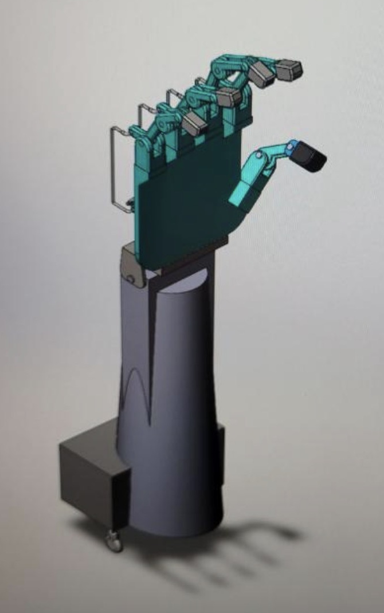
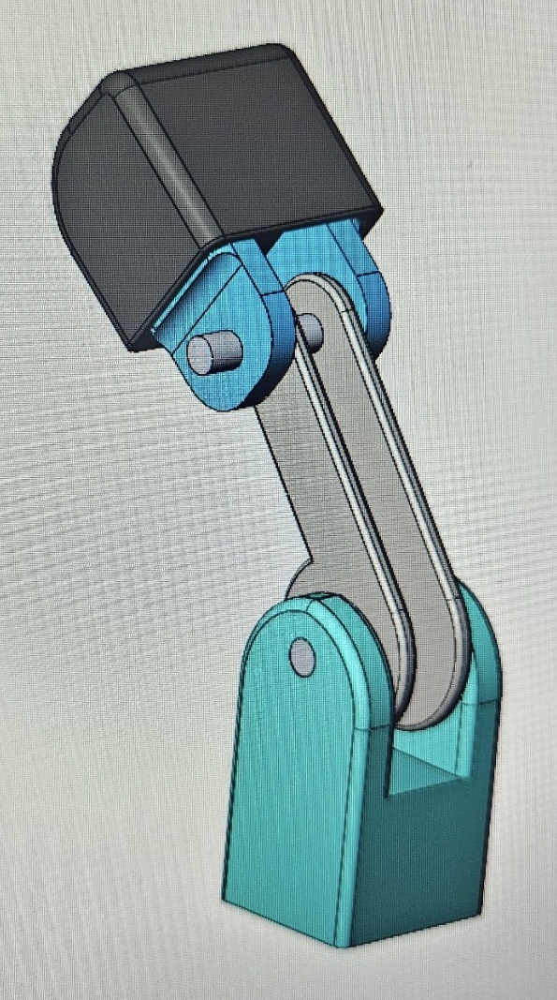
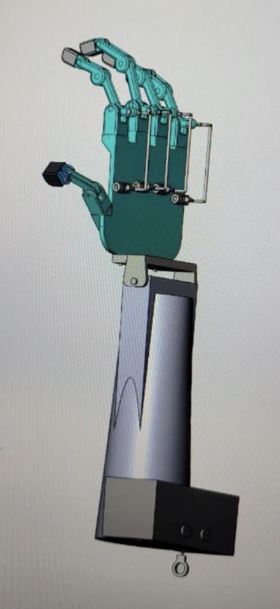

# Prosthetic Hand – SolidWorks CAD Design

Team design project for ENES 272 (Advanced CAD), University of Maryland.
Five-person team; I was the lead CAD designer.

## Overview

A SolidWorks model of a prosthetic hand and forearm. Four fingers and an
opposing thumb are driven by pinned linkages, with the geometry kept
within human-hand proportions.

## My role

- Led CAD for the team
- Designed the internal motor housing and the finger actuation mechanism
- Verified finger articulation and grip with SolidWorks motion studies
- Created tolerance-specified drawings for 3D printing

## Images

**Finger linkage detail:** one finger's mechanism, showing the knuckle
mount, the connecting link, the pinned joints, and the fingertip. This
is the linkage I checked in motion studies.

**Palm-side view:** the full assembly from the palm side, showing the
rods that drive the fingers, the wrist bracket, and the forearm. The
black box at the base of the forearm is the motor housing.

## Tools

SOLIDWORKS: part modeling, assemblies, motion studies, technical drawings

## About these images

The original CAD files were lost after the course. These photos of the
assembly on screen are the remaining record of the design. The images
above are cropped; the uncropped photos are in
[images/original](images/original/).

## Credits

Designed with a five-person team in ENES 272 at the University of
Maryland.
